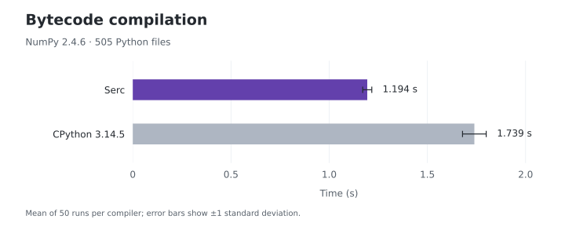

# Benchmarks

Serc is benchmarked against CPython's `compileall` using NumPy as a real-world
Python package. The results below were recorded on Linux with an AMD EPYC 7763
and CPython 3.14.5.

A few caveats apply:

- Performance depends on the hardware, operating system, filesystem, and Python
  sources being compiled. These results describe this workload and machine.
- Existing `.pyc` files are removed before every run, but OS filesystem caches
  are left warm. These measurements do not represent a cold filesystem cache or
  a parallel compilation workload.

Shorter bars indicate faster compilation.

## Bytecode compilation

Benchmarking compilation of NumPy 2.4.6: 505 Python files totaling 9,443,546
bytes. This is equivalent to compiling a package after installation, before its
first import.

Each command starts a fresh process, discovers and reads the sources, compiles
at optimization level 0, marshals the bytecode, and writes timestamp-invalidated
`.pyc` files. Both compilers process files sequentially. The reproduction
harness selects one worker explicitly with Serc `--jobs 1` and CPython `-j 1`.
Cache-file cleanup happens outside the timed command.



Serc compiled NumPy **1.46× faster** than CPython in this benchmark. The chart
shows mean wall-clock time across 50 runs per compiler; error bars show sample
standard deviations. An untimed preflight verified that all 505 output paths and
complete `.pyc` contents matched byte for byte. See the
[compatibility guide](docs/compatibility.md) for broader compatibility results.

<details>
<summary>Measurement details and raw results</summary>

Recorded September 20, 2026, on a Linux x86-64 VM with 32 AMD EPYC 7763 vCPUs,
with both compilers pinned to CPU 19:

- Serc
  [`1b57c9c`](https://github.com/astral-sh/serc/commit/1b57c9c33f7586a85d8a7ae2a5f3dd3b9e6a5cec),
  built with the release profile and Rust 1.97.0.
- CPython 3.14.5 and Hyperfine 1.20.0.
- NumPy
  [`v2.4.6`](https://github.com/numpy/numpy/tree/b832a09cf2a169c833dd2371e7c07aa00b293242).

The benchmark was run in both command orders, with five untimed warmups and 25
measured runs per compiler in each order. Times are means ± sample standard
deviations; the combined row pools both orders. Speedup is the CPython mean
divided by the Serc mean.

| Run order       | Runs per compiler |                  Serc |  CPython `compileall` |   Speedup |
| --------------- | ----------------: | --------------------: | --------------------: | --------: |
| CPython first   |                25 |     1.202 s ± 0.029 s |     1.717 s ± 0.026 s |     1.43× |
| Serc first      |                25 |     1.186 s ± 0.009 s |     1.761 s ± 0.075 s |     1.49× |
| **Both orders** |            **50** | **1.194 s ± 0.023 s** | **1.739 s ± 0.060 s** | **1.46×** |

The chart and table use the checked-in
[raw samples](scripts/benchmarks/results/numpy-2026-09-20.csv).

</details>

## Profile-guided release comparison

A separate [ordinary-release versus PGO comparison](docs/pgo-performance.md)
measured 10–11% lower complete compile-and-write time on held-out Django and NumPy.
It records paired samples, exact build/runtime commands, full output checks, and
small import-benchmark regressions. The PGO artifact is opt-in; ordinary release
builds are unchanged.

## Reproduction

The [benchmark harness](scripts/benchmarks/README.md) wraps
[`hyperfine`](https://github.com/sharkdp/hyperfine) and requires Git, the pinned
Rust toolchain, CPython 3.14.5, and Hyperfine 1.20.0. It builds release Serc and
verifies byte-for-byte output compatibility before timing.

From the repository root, set up the pinned NumPy corpus and run the benchmark.
On Linux, substitute an available CPU for `19`:

```sh
./scripts/benchmarks/setup.sh
PYTHON=/path/to/python3.14.5 HYPERFINE_WARMUP=5 HYPERFINE_MIN_RUNS=25 \
  taskset -c 19 ./scripts/benchmarks/run.sh
```

Results are written to `target/benchmarks/results/numpy.{json,md,metadata.txt}`.
The published results use the Serc revision listed above; running the harness
benchmarks your checkout.

<details>
<summary>Repeat with Serc first</summary>

The harness runs CPython first. To repeat the measurement in the opposite order
after running the harness, use the following command from the repository root.
Adjust the CPU and binary path if needed, including when Cargo uses a custom
target directory.

```sh
(
  export BENCH_PYTHON=/path/to/python3.14.5
  export BENCH_SERC="$PWD/target/release/serc"
  export BENCH_CORPUS="$PWD/target/benchmarks/numpy/numpy"
  BENCH_CPU=19
  taskset -c "$BENCH_CPU" hyperfine --warmup 5 --min-runs 25 \
    --prepare 'find "$BENCH_CORPUS" -type d -name __pycache__ -prune -exec rm -rf {} +' \
    --prepare 'find "$BENCH_CORPUS" -type d -name __pycache__ -prune -exec rm -rf {} +' \
    '"$BENCH_SERC" compile --quiet --jobs 1 "$BENCH_CORPUS"' \
    '"$BENCH_PYTHON" -I -S -m compileall -q -f -j 1 -o 0 --invalidation-mode timestamp "$BENCH_CORPUS"'
)
```

</details>

For benchmarks of individual compiler phases, see the
[Criterion and corpus benchmarks](crates/serc_benchmark/README.md).
