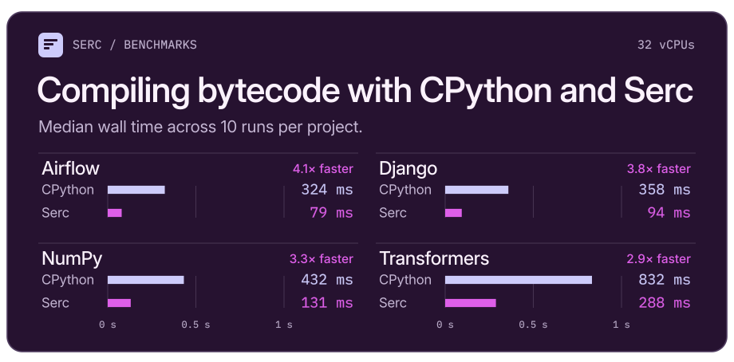

# Serc

An experimental CPython bytecode compiler, written in Rust.

Serc produces byte-for-byte identical output (as compared to CPython) on an
extensive corpus of real-world Python code, including
[Django](https://github.com/django/django),
[Airflow](https://github.com/apache/airflow), and
[Transformers](https://github.com/huggingface/transformers), across CPython
3.12, 3.13, 3.14, and 3.15, and optimization levels 0, 1, and 2, all while
compiling [3-4x faster](BENCHMARKS.md#project-compilation) than CPython’s
`compileall`.

<p align="center">
  
</p>

But Serc is also experimental! And so may emit incorrect bytecode in some cases.


> [!WARNING]
>
> Serc is experimental. This README is human-edited, but all code changes, PR
> summaries, and additional documentation were authored entirely by GPT in
> Codex.

## Installation

Install from [crates.io](https://crates.io/crates/serc-cli) with Rust 1.96 or
later:

```console
cargo install serc-cli --locked
```

## Getting started

Given `hello.py`:

```python
def greet(name):
    return f"Hello, {name}!"
```

Compile to bytecode, emitted at `__pycache__/hello.cpython-314.pyc`:

```console
serc compile hello.py
```

Pass a directory to compile its Python files recursively, or use `--check` to
compile without writing cache files:

```console
serc compile path/to/package
serc compile --check path/to/package
```

Compilation uses the available CPUs by default. Use `--jobs` (or `-j`) on the
command line or the `RAYON_NUM_THREADS` environment variable to set a limit,
including `--jobs 1` for serial compilation.

```console
serc compile --jobs 4 path/to/package
```

By default, Serc skips files whose `.pyc` is up to date by checking the bytecode
format and invalidation mode, then comparing the source file's timestamp and
size (for timestamp-based caches) or its content hash (for hash-based caches).

Pass `--force` (or `-f`) to recompile every file, for example after switching
compilers or native build profiles. (Even with `--force`, Serc refuses to
overwrite symlinks or special files.)

### Python version

Serc emits Python 3.14-compatible bytecode by default, but supports target
selection with `--python-version`. For example, to emit Python 3.15 bytecode:

```console
serc compile --python-version 3.15 path/to/package
```

Serc supports the following CPython minor versions:

| Target | Pinned CPython release |
| ------ | ---------------------- |
| `3.12` | 3.12.14                |
| `3.13` | 3.13.15                |
| `3.14` | 3.14.5                 |
| `3.15` | 3.15.0rc2              |

Each target writes its own cache tag and bytecode magic number, so the four
versions can coexist under `__pycache__`.

### Optimization

Use `-O` to remove assertions and set `__debug__` to false, matching Python's
`-O` mode. Use `-OO` to additionally remove module, class, and function
docstrings:

```console
serc compile -O hello.py
serc compile -OO hello.py
```

You can also select the level explicitly with `--optimize 0`, `--optimize 1`, or
`--optimize 2`. Level 0 is the default. Optimized caches use Python's naming
convention, such as `__pycache__/hello.cpython-314.opt-1.pyc` and
`__pycache__/hello.cpython-314.opt-2.pyc`, so all three levels can coexist.

## Library integration

Add Serc to your `Cargo.toml`:

```toml
[dependencies]
serc = "0.1.0"
```

Compile Python source and serialize the resulting code object in CPython's
marshal format:

```rust
let module = serc::compile("print('Hello, world!')\n", "hello.py").unwrap();
let marshaled = module.marshal();
```

## License

Serc is licensed under either of

- Apache License, Version 2.0, ([LICENSE-APACHE](LICENSE-APACHE) or
  <https://www.apache.org/licenses/LICENSE-2.0>)
- MIT license ([LICENSE-MIT](LICENSE-MIT) or
  <https://opensource.org/licenses/MIT>)

at your option.

Unless you explicitly state otherwise, any contribution intentionally submitted
for inclusion in Serc by you, as defined in the Apache-2.0 license, shall be
dually licensed as above, without any additional terms or conditions.
